# maritime-vision-suite

Computer vision pipeline for sailing race footage, built around a camera
mounted on the mast: sea/sky segmentation, boat detection, and — the
differentiating goal — locating gust/lull patches on the water surface from
their texture, as a tactical aid for routing decisions during a race.

Today the code is a minimal OpenCV frame-reading harness with live FPS
measurement; it's the frame-ingestion layer the stages below will be built
on top of.

## Current state

What's actually implemented right now (`detection/python/src/`):

- `video_loader.py` / `main.py` — opens a video file with OpenCV, reads it
  frame by frame, overlays a live FPS counter, exits on `q`.
- `config.py` — paths and display settings.

**Not implemented yet:** everything described in the roadmap below. This
README describes the target scope; the code above is only the starting
point.

## Roadmap

- [x] **Sea/sky horizon detection (classical baseline)** — see below
- [x] **Sea/sky segmentation (learned model)** — see below; replaces the
  single-line baseline with a CNN that handles coastline/obstacles directly
- [x] **Boat detection (YOLOv8n)** — see below. Four checkpoints
  measured and compared on real sailing/AC75 photos (zero-shot,
  SeaShips-only, +Open Images, +Open Images+sailing-specific Roboflow
  data); the last one is the first to match zero-shot's recall on
  both test sets, after two earlier attempts that didn't.
  [SMD](https://sites.google.com/site/dilipprasad/home/singapore-maritime-dataset)
  and actual race-broadcast footage are still not integrated — current
  AC75-specific free imagery is too scarce for training, only for
  testing (see Datasets below)
- [ ] **Wind-zone detection** — no dataset or prior work exists for this, so
  it's framed as an **unsupervised** problem, not classification:
  - Segment relatively rougher/darker water patches (gusts/"cat's paws")
    from relatively smoother ones in the *same frame* — local texture
    contrast (Gabor response, high-frequency FFT energy) rather than an
    absolute brightness threshold, which breaks under cloud shadow/glare
  - Add **optical flow** as a second, independent signal: ripple motion
    differs between gust and calm patches even when lighting is deceptive
  - **Validation methodology** (this is the part that actually needs to
    hold up): correlate a flagged patch against the boat's own anemometer
    reading once the boat sails into it, logged over many crossings. No
    external ground truth exists, so this self-supervised comparison is
    the only honest way to report an accuracy number instead of "looks
    right"
  - Known failure modes to document, not hide: sun glare, cloud-shadow
    confounds, mast sway/vibration destabilizing the frame
- [ ] Quantitative wind speed/direction estimation from wave state —
  exploratory, reported with explicit error bars against real wind data,
  not sold as anemometer-equivalent
- [ ] Simple rule-based manoeuvre suggestions (e.g. route toward a detected
  gust, flag a tack on an apparent wind shift) on top of the stages above
- [ ] Latency benchmarks (p50/p99) on target hardware
- [x] Unit tests + CI
- [x] Remove hardcoded local video path, read from `config.py` / CLI arg

## Sea/sky horizon detection (classical baseline)

`segmentation/src/horizon.py` estimates the horizon as a single straight
line per frame: Canny edges, probabilistic Hough transform to find
near-horizontal segments, weighted least-squares fit across them. No
training, no GPU — a measurable starting point before a learned model.

**Limitation by construction:** a straight line can't represent a
coastline or an obstacle crossing the horizon. `evaluate_horizon.py` scores
the detector only on mask columns that are a clean sky-then-water
transition, and reports what fraction of columns actually qualify — so the
number isn't silently inflated by skipping the hard cases.

Measured on the **full** MaSTr1325 dataset, 1325 images
(`scripts/evaluate_horizon.py`):

```
Images evaluated: 414 (skipped: 911 — no clean sky/water columns, e.g. coastline or a large obstacle fills the frame)
Mean fraction of columns with clean ground truth: 31.0%
Pixel error over all valid columns, all images:
  MAE:    16.5 px
  Median: 7.1 px
  Std:    16.8 px
Per-image MAE: mean 15.6 px, worst 77.1 px, best 0.2 px
```

Two things worth being upfront about. First, **69% of the dataset (911/1325
images) has no column this metric can even score** — the straight-line
assumption isn't just imprecise on those, it's inapplicable, and that
fraction is the more honest signal than the pixel error itself. Second,
per-image mean MAE (15.6px) is in the same range as published deep
segmentation baselines on the related MODD2 benchmark (SegNet 13.5px,
PSPNet 13.8px — see [MODD2 leaderboard](https://box.vicos.si/borja/viamaro/index.html))
— but again only on the third of images with an easy, mostly-open-water
scene, and with a long tail: worst case 77.1px. This is a baseline to
beat, not a result to lean on.

(An earlier 50-image dev sample gave a rosier-looking 12.3px mean MAE —
the gap shows why evaluating on a tiny sample before scaling up would have
been misleading.)

Run it yourself:

```bash
python scripts/fetch_mastr1325_sample.py --n 1325   # the whole dataset
python scripts/evaluate_horizon.py
```

**Visual results** — each image is two panels. Left: red is the predicted
horizon, green dots are ground truth but **only drawn on the clean columns
the metric actually scores** (no coastline/obstacles in that column) — on
a coastline-heavy image this can look nearly empty, which is correct, not
missing data. Right: the full ground-truth mask with nothing filtered out
(orange=sky, blue=water, red=obstacle, gray=ignore), so you can always see
what the left panel's green dots are a subset of.

| Best (0.2px) | Median (6.4px) | Worst (77.1px) |
|---|---|---|
| 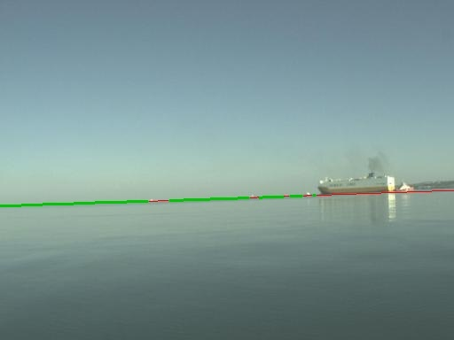 | 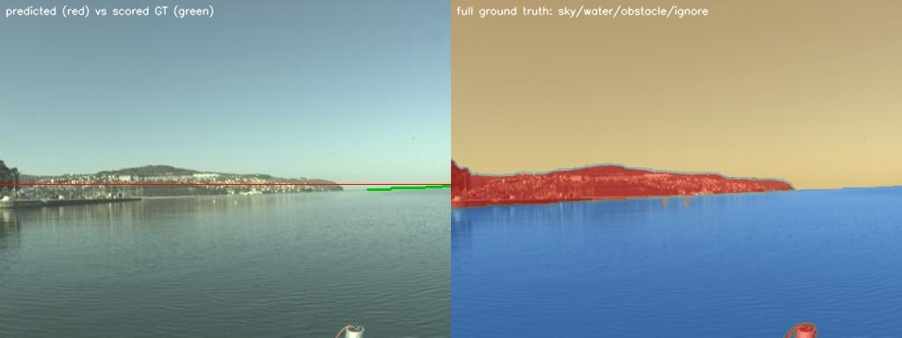 | 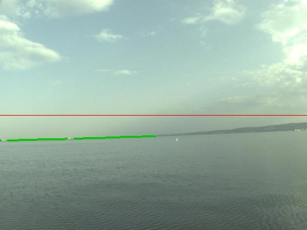 |

The median example shows a ship sitting on the horizon with a mild slope
mismatch between predicted and ground truth — the kind of error a learned
model should close. The worst case is a large obstacle (a pier/mooring
structure) filling most of the frame under heavy haze: only a thin strip
of open water is left to score, and the line locks onto the haze band well
above the real waterline — visible directly by comparing the red line
against the blue water region on the right panel.

Generate overlays for the whole sample with:

```bash
python scripts/visualize_horizon.py
# writes to data/outputs/horizon_overlays/ (gitignored, regenerate locally)
```

## Sea/sky segmentation (learned model)

`segmentation/src/model.py` is a small U-Net (3 down/up stages, base
width 16, ~1.9M params) trained from scratch — no pretrained weights, no
GPU, on CPU in 22 minutes on the full MaSTr1325 dataset. It predicts a
per-pixel class (obstacle/water/sky) directly, so unlike the single-line
baseline it isn't structurally blind to coastline or obstacles.

Training: 1325 images, 1127 train / 198 val (fixed 85/15 split, seed 42),
30 epochs, Adam, images resized to 192×256, best checkpoint kept by val
mIoU (not just the last epoch — training was noisy, with two epochs
dropping to 0.37 and 0.90 mIoU before recovering, likely the LR being a
bit high for this model size).

```bash
pip install -r requirements-segmentation.txt --index-url https://download.pytorch.org/whl/cpu
python scripts/train_segmentation.py --epochs 30
```

**Results on the full 198-image validation set — 100% of it, not 31%:**

```
Best val mIoU: 0.9810
Per-class IoU:
  obstacle  : 0.9543
  water     : 0.9921
  sky       : 0.9967
Pixel accuracy: 0.9957
```

This is the direct payoff of switching from a geometric assumption to a
learned model: the classical baseline could only be scored on columns
with a clean sky/water transition (31% of the dataset) and still landed
around 15.6px MAE; the CNN is scored on every validation image, full
frame, and reaches 0.981 mIoU. The two numbers aren't on the same scale
(pixel error vs IoU), so treat this as "handles the other 69% of cases
the baseline couldn't touch at all," not a like-for-like percentage
comparison.

**Visual comparison** (predicted vs ground truth, same color coding as
above):

| Best (mIoU 1.000) | Median (mIoU 0.988) | Worst (mIoU 0.787) |
|---|---|---|
| 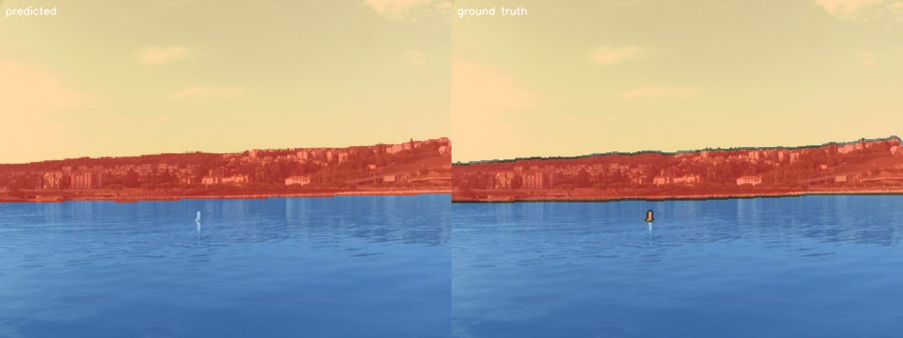 | 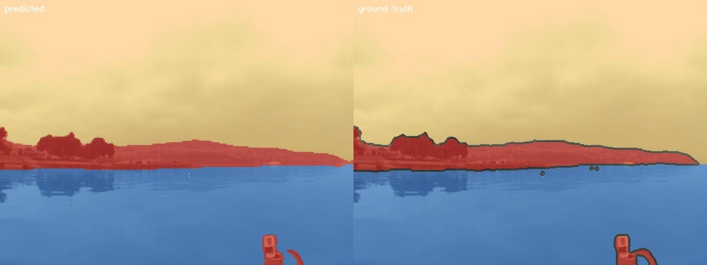 | 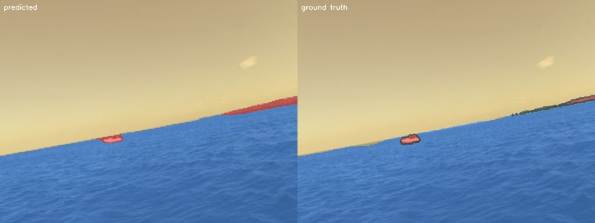 |

Median shows a complex coastline (trees, buildings, a small buoy) matched
almost pixel-for-pixel — the case that broke the straight-line baseline
outright. Even the worst case is a minor disagreement on exactly where an
obstacle's far edge ends under an ambiguous (ignore-labelled) boundary
region, not a structural failure like the baseline's haze/horizon
confusion.

Run it yourself (needs a trained checkpoint, see above):

```bash
python scripts/visualize_segmentation.py
```

**Known limitations, not hidden:** trained on 1325 images from one
geographic area (gulf of Koper, Slovenia) with a fixed USV camera height
— generalization to a mast-mounted camera on a sailing boat, different
water/lighting conditions, and open-ocean scenes with no coastline at all
is untested, not assumed. The training instability (two mid-training mIoU
drops) also suggests the learning rate schedule is worth revisiting before
this becomes anything more than a baseline for the next stage.

## Boat detection

`boat_detection/src/model.py` wraps [ultralytics
YOLOv8n](https://github.com/ultralytics/ultralytics) — COCO-pretrained,
~3M params, already ships a "boat" class. `boat_detection/src/dataset.py`
converts [SeaShips(7000)](#datasets)'s Pascal VOC annotations to YOLO
labels, collapsing its six ship-type classes (cargo carrier, container
ship, fishing boat, etc.) into one: this project asks "is there a boat",
not ship taxonomy.

Measured the same way as the horizon baseline — a number before any
training, not a result to lean on — on a fixed-seed 1500-image sample
(1200 train / 300 val, 396 ground-truth boxes), using ultralytics' own
`val()` rather than a hand-rolled metric (see below for why):

```
                              mAP50    mAP50-95   Precision   Recall
Zero-shot (stock yolov8n.pt)  0.945     0.616      1.000      0.944
Fine-tuned (40 epochs)        0.995     0.774      1.000      0.995
```

```bash
pip install -r requirements-detection.txt --index-url https://download.pytorch.org/whl/cpu
python scripts/fetch_seaships_sample.py --n 1500
python scripts/evaluate_boat_detection.py                                            # zero-shot
python scripts/train_boat_detection.py --epochs 40 --checkpoint data/checkpoints/yolov8n_boats.pt
python scripts/evaluate_boat_detection.py --checkpoint data/checkpoints/yolov8n_boats.pt
```

**mAP alone understates what fine-tuning actually fixed.** An earlier run
on a much smaller sample (120 train / 30 val — still in the git history)
showed fine-tuned and zero-shot landing on nearly identical mAP50
(0.975 both), which on its own reads as "fine-tuning didn't help." It
missed the real story, visible only by checking predictions at a fixed,
practical confidence threshold (0.25 — what you'd actually use, not the
threshold-sweep mAP integrates over) instead of trusting the aggregate
metric alone:

```
                          images with zero       images with at least
                          detections @conf=0.25  one missed box (IoU<0.5)
Zero-shot                 34%                     61%
Fine-tuned (120 train)    40%                     ~53%
Fine-tuned (1200 train)    0%                      3%
```

The zero-shot model *can* localize most SeaShips boats (that's what the
high mAP measures, since mAP sweeps every confidence level including
near-zero ones) but is rarely *confident* about them — COCO's "boat"
class never saw this specific port/hull style, so at a threshold you'd
actually deploy with, it misses most of the time. Fine-tuning on only
120 images didn't fix that calibration problem (not enough signal to
learn confident predictions, same root cause as the still-close mAP).
Fine-tuning on 1200 images did: zero images with no detection at all,
and the model's confidence is now trustworthy at a normal operating
threshold, not just somewhere on the full sweep. This is the more
honest headline number for "does fine-tuning work here" than mAP alone
— confirmed by rerunning the exact same check, nothing cherry-picked.

**On the metric itself:** an earlier version of this evaluation used a
hand-rolled IoU-matching AP (same approach as `evaluate_horizon.py`). It
turned out to be mathematically correct — verified line-for-line against
ultralytics' own `ap_per_class` fed identical inputs — but wildly
unstable on a validation set this small (34 boxes): a handful of
overlapping candidate boxes on a couple of cluttered images (one
elongated ore carrier spanning almost the full frame produced ~140
overlapping candidate boxes) can flip which single detection gets
credited as *the* match, swinging the reported number by 50+ points
(0.43 vs 0.975 on the exact same checkpoint) without the model changing
at all. Rather than present a self-built metric with that much variance
as a real result, `evaluate_boat_detection.py` now uses ultralytics' own
validator directly — including for the zero-shot case, via a second
label set that relabels ground truth at COCO's own "boat" class index so
the un-fine-tuned 80-class model can be scored fairly. This instability
is itself the more honest takeaway than either individual number: mAP on
a 30-image eval set is noisy, full stop.

**Visual comparison** (red: predicted, green: ground truth, the
1200-image fine-tuned checkpoint):

| Best (IoU 0.99) | Median (IoU 0.88) | Worst (IoU 0.43) |
|---|---|---|
| 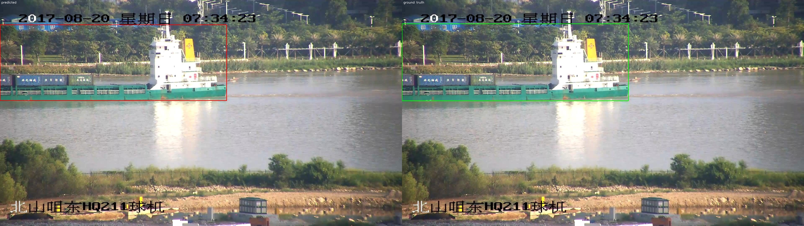 | 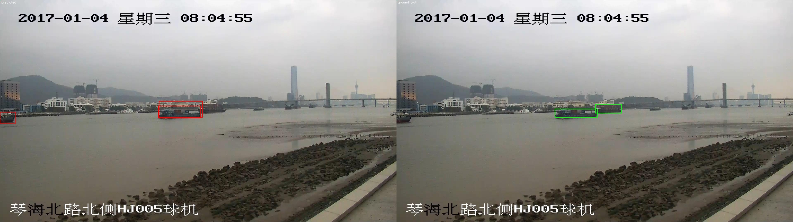 | 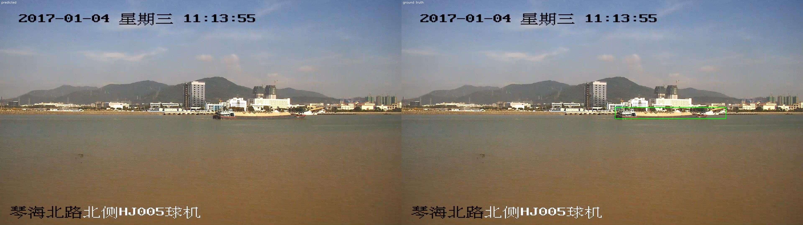 |

The worst case here is a real but minor localization error, not a miss:
two ships close together, a container ship and a smaller vessel further
back, where the model only boxes the nearer one — visible by comparing
against the two separate ground-truth boxes on the right. Median is now
0.88 IoU, not 0.36 — a direct, visible consequence of the confidence-
calibration fix above, not just a better aggregate number.

**Known limitations, not hidden:** SeaShips is shore-camera footage of
commercial shipping at a fixed Chinese port — a real domain gap from a
mast-mounted camera on a sailing boat in open water (different hull
shapes, no recreational sailboats at all, fixed camera vs. a moving,
vibrating mast). SMD ships as raw multi-GB video with a custom
per-frame ground-truth format (horizon + tracking + detection
combined), which needs its own frame-extraction and parsing pipeline —
a separate chunk of work from this stage, still not integrated. The
numbers above use `--n 1500 --epochs 40`, not the scripts' lighter
quick-start defaults (`--n 150`, `--epochs 30`) — this page is itself
the evidence that the lighter defaults under-train the model's
confidence calibration, so anyone reproducing a real result here needs
the larger flags.

### Domain generalization test: does it actually work on real sailing photos?

The limitation above was a prediction. This section is the test of it —
and the fine-tuned checkpoint fails it badly.

`scripts/test_on_real_sailing_photos.py` runs a checkpoint on photos
that aren't SeaShips: no ground truth (these aren't an annotated
dataset), just boxes and confidences to look at directly. Two small
free-license sets, fetched reproducibly:

```bash
python scripts/fetch_sailing_test_photos.py   # 4 classic-sailboat photos, Unsplash License
python scripts/fetch_ac75_test_photos.py      # 11 AC75/foiling photos, Wikimedia Commons (CC, attributed in CREDITS.md)
python scripts/test_on_real_sailing_photos.py --images-dir data/datasets/sailing_test_photos --checkpoint data/checkpoints/yolov8n_boats.pt
python scripts/test_on_real_sailing_photos.py --images-dir data/datasets/ac75_test_photos --checkpoint data/checkpoints/yolov8n_boats.pt
```

(AC75/foiling test photos deliberately *aren't* from YouTube or
broadcast footage — that's copyrighted content this repo won't
redistribute. Wikimedia Commons' AC75-tagged categories hold under 15
CC-licensed photos total across every team combined; see Datasets
below for why that's also the ceiling on fine-tuning with this kind of
boat specifically, not just a sourcing inconvenience for testing.)

**Boxes found per image, at the same conf=0.25 threshold used above:**

| | 4 classic sailboat photos | 11 AC75/foiling photos |
|---|---|---|
| Zero-shot | 14 boxes, **0 images missed** | 30 boxes, **0 images missed** |
| Fine-tuned on SeaShips only | 1 box, 3 images missed | 7 boxes, 5 images missed |

The SeaShips fine-tune — the one with mAP50-95 0.774, better than
zero-shot on every metric measured above — is nearly blind to actual
sailboats. Not "a bit worse," blind: 3 of 4 classic-sailboat photos get
zero detections, and foiling AC75s (a hull shape that looks nothing
like a cargo ship: no hull visible in the water, thin foil arms, a
rigid wingsail on modern boats) fare even worse. This is catastrophic
forgetting, not mild overfitting as the smaller-sample result earlier
suggested — 40 epochs on a single narrow visual domain (commercial
ships, one port) overwrote enough of what COCO's pretrained "boat"
class already knew to break it on anything else.

**The fix attempted: mix in a more varied generic-boat dataset instead
of fine-tuning on SeaShips alone.**
[Open Images V7](https://storage.googleapis.com/openimages/web/index.html)'s
"Boat" class (jet skis, dinghies, yachts, canoes — far more varied than
commercial shipping) is combined with SeaShips and fine-tuned for only
10 epochs (not 40 — a lighter touch is itself part of not overwriting
general knowledge again):

```bash
python scripts/fetch_openimages_boats_sample.py --n 500
python scripts/make_combined_boat_dataset.py
python scripts/train_boat_detection.py --epochs 10 --data data/datasets/combined/data.yaml --checkpoint data/checkpoints/yolov8n_boats_combined.pt
```

| | 4 classic sailboat photos | 11 AC75/foiling photos |
|---|---|---|
| Zero-shot | 14 boxes, 0 missed | 30 boxes, 0 missed |
| Fine-tuned on SeaShips only | 1 box, 3 missed | 7 boxes, 5 missed |
| Fine-tuned on SeaShips + Open Images | 6 boxes, 1 missed | 22 boxes, 1 missed |

Better, but mAP alone on that run (0.510) was still catching no
sailboats specifically — Open Images' "Boat" class is varied (jet
skis, dinghies, yachts) but has no dedicated sailboat label, so the
model was never shown "this is what a sail looks like" as its own
concept. A search for a genuinely sailing-specific free dataset turned
up [Roboflow Universe's "Sailboat
detector"](https://universe.roboflow.com/learning-299jh/sailboat-detector)
(CC BY 4.0, 8,888 images, 11 vessel-type classes including a dedicated
`sailboat` label) — adding 1,200 of those images to the mix (collapsed
to this project's single `boat` class) and fine-tuning the same 10
epochs:

```bash
export ROBOFLOW_API_KEY="..."   # free account at roboflow.com, required by the
                                 # platform to download regardless of the CC license
python scripts/fetch_roboflow_sailboat_sample.py
python scripts/make_combined_boat_dataset.py
python scripts/train_boat_detection.py --epochs 10 --data data/datasets/combined/data.yaml --checkpoint data/checkpoints/yolov8n_boats_combined3.pt
```

| | 4 classic sailboat photos | 11 AC75/foiling photos |
|---|---|---|
| Zero-shot | 14 boxes, 0 missed | 30 boxes, **0 missed** |
| Fine-tuned on SeaShips only | 1 box, 3 missed | 7 boxes, 5 missed |
| Fine-tuned on SeaShips + Open Images | 6 boxes, 1 missed | 22 boxes, 1 missed |
| **+ Roboflow sailboat-specific data** | 7 boxes, **0 missed** | **32 boxes, 0 missed** |

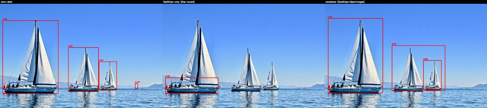
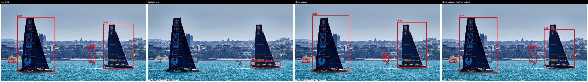

**The honest verdict, updated: adding genuinely sailing-specific
training data closed the gap that generic data alone couldn't.** This
is the first fine-tuned checkpoint to miss zero images on both test
sets, matching zero-shot's recall, and on the AC75 set it finds more
boxes than zero-shot (32 vs 30) despite AC75 foiling hulls never
appearing in training at all. It still trails zero-shot on raw box
count for classic sailboats (7 vs 14 — the sailing_test_1 example
above shows it catching 2 of 4 boats zero-shot gets, up from 0 for
both earlier fine-tunes but not yet all 4), and mAP50-95 on its own
val set (0.343) is the lowest of all three fine-tuned runs — more
domain diversity in the training mix costs aggregate-metric headroom
even as it fixes the specific real-world failure this section exists
to catch. The lesson carried through this whole investigation: **mAP
on the fine-tuning dataset told the opposite story from testing on
real target-domain photos at every single step** — the better-looking
number was the wrong signal all three times.

**Does more training on this 3-source mix help further, or start
re-triggering the same forgetting?** Both — a genuine trade-off, not a
clean win. 25 epochs instead of 10 on the same data:

| | 4 classic sailboat photos | 11 AC75/foiling photos |
|---|---|---|
| 3-source mix, 10 epochs | 7 boxes, 0 missed | 32 boxes, 0 missed |
| 3-source mix, 25 epochs | **11 boxes, 0 missed** | 26 boxes, **1 missed** |

Classic-sailboat detection improved (closer to zero-shot's 14), but
AC75 performance regressed — including missing a frame the 10-epoch
checkpoint caught, where two AC75s overlap with their sails nearly
vertical and little hull visible, a pose that looks nothing like the
hull-plus-triangular-sail shape Roboflow's dataset mostly shows. More
training pulled the model toward "sailboat" as Roboflow depicts it, at
some cost to generalizing beyond that shape — the same failure mode as
the original SeaShips-only run, just much milder since the training
mix is far more varied this time. **The 10-epoch checkpoint is the one
to use**: it's the only one with zero missed images on both test sets,
and more training didn't uniformly improve on that.

Not yet tried: a larger Roboflow sailboat sample (1,200 of the
available 7,113 were used here), or an explicit general-feature-
preserving training method (frozen backbone layers, EWC-style
regularization, lower learning rate) that might let more epochs help
without this trade-off.

## Datasets

- **[MaSTr1325](https://box.vicos.si/borja/viamaro/index.html)** (CC BY 4.0,
  Bovcon et al., IROS 2019) — 1325 USV-camera images with per-pixel
  sea/sky/obstacle masks. A reproducible 50-image sample is fetched with:

  ```bash
  python scripts/fetch_mastr1325_sample.py
  ```

  This downloads the full dataset into `data/_cache/` (gitignored) and
  copies a fixed-seed sample into `data/datasets/mastr1325_sample/`. 50
  is a quick-start default, not a training set — the full dataset is only
  ~24MB, so for anything beyond a quick look at the baseline, pull more:

  ```bash
  python scripts/fetch_mastr1325_sample.py --n 1325   # the whole dataset
  ```

- **[LaRS](https://lojzezust.github.io/lars-dataset/)** (ICCV 2023) — larger
  and more diverse panoptic maritime dataset, gated behind a request form
  (name/email/affiliation/intended use). Not yet requested.

- **[SeaShips(7000)](https://sites.ucmerced.edu/files/wdu/files/seaship.pdf)**
  (Shao et al., IEEE Transactions on Multimedia, 2018) — 7000 images of
  commercial ships at a Chinese coastal port, Pascal VOC boxes across six
  ship-type classes. The original paper has no clearly published
  redistribution license of its own; this project fetches a [public
  Hugging Face mirror](https://huggingface.co/datasets/datnguyentien204/Seaship7000)
  for the same academic/portfolio research use the dataset is normally
  cited for. A reproducible sample is fetched with (`--n 150` is a
  quick-start default; the boat detection results above use `--n 1500`,
  since the smaller sample under-trains the model's confidence):

  ```bash
  python scripts/fetch_seaships_sample.py --n 1500
  ```

- **[Open Images V7](https://storage.googleapis.com/openimages/web/index.html)**
  "Boat" class (Google, CC BY 4.0 annotations; underlying photos carry
  per-image Creative Commons licenses from their Flickr sources, which is
  what Open Images is built and licensed for) — far more visually varied
  than SeaShips (jet skis, dinghies, yachts, canoes, not just commercial
  shipping). Only the validation split's annotations are used (25MB vs.
  2.2GB for the full train split) — 567 images have at least one
  individually-boxed boat:

  ```bash
  python scripts/fetch_openimages_boats_sample.py --n 500
  ```

- **[Roboflow Universe: Sailboat detector](https://universe.roboflow.com/learning-299jh/sailboat-detector)**
  (CC BY 4.0, 8,888 images, 11 vessel-type classes including a
  dedicated `sailboat` label — genuinely sailing-specific, unlike Open
  Images' generic `Boat`) — the dataset that closed the domain gap Open
  Images alone couldn't (see Boat detection above). Needs a free
  Roboflow account and API key to download (the platform requires one
  regardless of the dataset's own license):

  ```bash
  export ROBOFLOW_API_KEY="..."   # from a free account at roboflow.com
  python scripts/fetch_roboflow_sailboat_sample.py   # 1,200/300 of the available 7,113/1,337
  ```

- **AC75/foiling test photos** — not a training dataset, a qualitative
  test set (see Boat detection above). Genuinely free-licensed AC75
  imagery is scarce: Wikimedia Commons' dedicated `AC75` and `Ineos
  Britannia` categories hold under 15 files combined, and
  `Alinghi Red Bull Racing` / `American Magic` have no Commons category
  at all. 11 photos across several teams (Ineos Britannia, Luna Rossa,
  Team New Zealand, with Alinghi visible in one) is close to what's
  realistically available today without using copyrighted broadcast
  footage:

  ```bash
  python scripts/fetch_ac75_test_photos.py
  ```

None of these datasets have sailing-specific gust/wind-zone annotations —
no such dataset exists (see roadmap above); that stage is unsupervised by
design.

## Requirements

```
numpy==2.2.6
opencv-python==4.12.0.88
scipy==1.15.3
```

## Running

```bash
python -m venv .venv
source .venv/bin/activate   # .venv\Scripts\activate on Windows
pip install -r requirements.txt
python detection/python/src/main.py
```

Place an input video at `data/videos/sample.mp4` (path configurable in
`config.py`).

## Testing

```bash
pip install pytest ruff
pip install -r requirements-segmentation.txt --index-url https://download.pytorch.org/whl/cpu --extra-index-url https://pypi.org/simple
pip install -r requirements-detection.txt --index-url https://download.pytorch.org/whl/cpu --extra-index-url https://pypi.org/simple

ruff check detection/python segmentation scripts boat_detection

# Run these separately, not combined into one `pytest a b c` call:
# segmentation/src/ and boat_detection/src/ both have same-named modules
# (model.py, dataset.py, metrics.py) added to sys.path by their
# conftest.py; collected together, the second package's imports
# silently resolve to the first package's modules.
pytest detection/python -v
pytest segmentation/tests -v
pytest boat_detection/tests -v
```

Runs on every push/PR via GitHub Actions (`.github/workflows/ci.yml`),
on Python 3.10 and 3.11.

## License

MIT — see [LICENSE](LICENSE).
